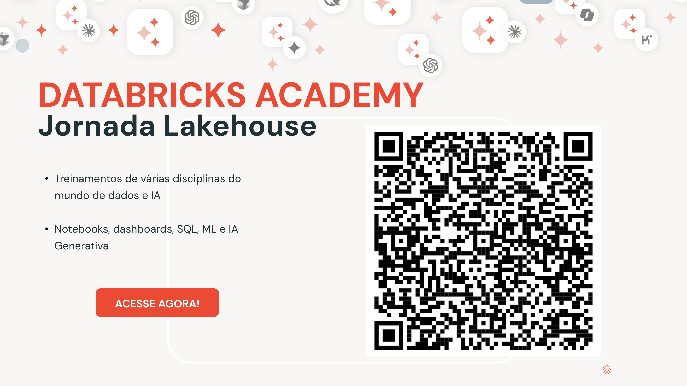

# 10 - Cierre (Próximos Pasos)

> _La plataforma completa que construiste a lo largo de la ruta, desde el dato crudo hasta la app de retención._

## 🎉 ¡Felicidades!

Llegaste al final del **Master Training**. Partiendo de una sola pregunta de negocio (*¿por qué los clientes cancelan y cómo retenerlos?*), recorriste la plataforma Databricks de punta a punta, en modo **low-code**, y entregaste un producto de retención completo.

## El desafío de churn, resuelto

Cerraste el ciclo **Detectar → Diagnosticar → Decidir → Actuar**, siempre sobre la misma base:

- **🔍 Detectar** quién está por cancelar: alertas, métricas gobernadas, dashboards y un modelo de ML que asigna un score de riesgo a cada cliente
- **🩺 Diagnosticar** el porqué: IA Generativa leyendo la "voz del cliente" en los tickets y agentes conversacionales que responden en español
- **🎯 Decidir** la oferta correcta: funciones gobernadas que transforman el score en una acción, con las reglas de negocio en SQL y la IA solo en la redacción
- **✅ Actuar**: la Central de Retención, la app que reúne todo y que el equipo de negocio usa día a día

## Lo que construiste

| Módulo | Entrega |
|--------|---------|
| **00 · Setup** | Base de churn gobernada en Unity Catalog (datos + documentación) |
| **01 · SQL con IA** | Explorar la base en el SQL Editor con Genie Code |
| **02 · Generación de Alertas** | Alertas que se disparan cuando un indicador de churn cruza un umbral |
| **03 · Métricas de Negocio** | Métricas gobernadas (churn, ingresos, soporte) reutilizables |
| **04 · IA Generativa en SQL** | AI Functions sobre los tickets: sentimiento, categoría, PII y resumen |
| **05 · Dashboards con IA** | Panel ejecutivo de churn en AI/BI, armado a partir de prompts |
| **06 · Predicción de Churn (ML)** | Modelo de probabilidad de churn + la tabla `churn_scores` |
| **07 · Análisis de Datos Multi-Agent** | Dos Genies (Facturación y Soporte) + un Supervisor que los orquesta |
| **08 · Retención con ML y GenAI** | UC Functions: el perfil 360 del cliente y el email de retención personalizado |
| **09 · Creación de Apps** | La **Central de Retención**: Cockpit + Asistente + Retención, en un único deploy, con la IA pasando por un model service del Unity Gateway |

Es el mismo patrón que llevas a cualquier caso de uso e industria: **datos → métricas → IA → agentes → app**, todo gobernado por Unity Catalog.

## Continúa la jornada 🚀

El churn fue solo el comienzo. Para profundizar en cada disciplina (SQL, dashboards, Machine Learning e IA Generativa), continúa en la **Databricks Academy · Jornada Lakehouse**:

- Entrenamientos de varias disciplinas del mundo de datos e IA
- Rutas prácticas de notebooks, dashboards, SQL, ML e IA Generativa

> 📱 Apunta la cámara del celular al código QR de arriba y accede a la ruta

---

¡Gracias por participar, y buenos proyectos! 👏
